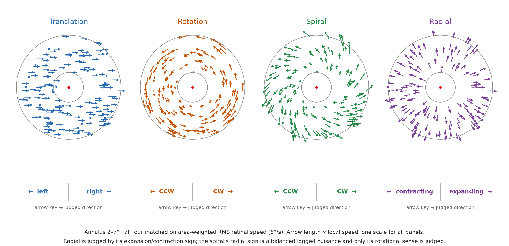

# Online RDK + Attentional-Load Experiment

A browser-based **random-dot motion direction-discrimination** task with a
**dual-task attentional-load** manipulation, built with
[jsPsych 7](https://www.jspsych.org/) and a custom HTML5-canvas RDK plugin.
Designed for online data collection via **Prolific**, hosted free on **GitHub
Pages**, with data saved to the **Open Science Framework (OSF)** through
**DataPipe**.

This is an open-source reimplementation and redesign of a desktop PsychoPy
vection study (see *Lineage* below). Because the original neck-vibration
hardware and large-field optic-flow engine cannot run in a browser, the online
study measures an **objective** motion-sensitivity performance measure, which is
robust to the uncontrolled displays, viewing distances, and refresh rates of
online participants.



---

## 1. What the experiment does

On each trial the participant sees a ring (annulus) of flickering white dots
around a central red fixation cross. A fraction of the dots (**coherence**)
move coherently in the run's motion pattern; the rest move randomly. The
participant judges the global direction (2-alternative forced choice).

The experiment supports **four motion types**, each run as a **separate study**
(see §1a): the coherent dots either **translate** (left / right), **rotate**
rigidly about fixation (clockwise / counter-clockwise), move in a **spiral**
(a balanced 45° "screw" — equal radial and rotational components, judged by
rotational sense), or move **radially** (pure expansion / contraction at a
uniform radial speed, judged by radial sign). All four are matched on
**area-weighted RMS retinal speed**,
so the low-level motion energy is equated and the direction-discrimination
threshold from each is a valid baseline for the corresponding pattern in the
desktop **vection** experiment (translation ↔ linear vection; rotation and
spiral ↔ *circular* vection).

Simultaneously, a rapid stream of letters (**RSVP**) is shown at fixation —
**6 letters × 150 ms = 900 ms**, inside the 1000 ms motion stimulus. A
between-block **attentional-load** manipulation changes what the participant
must do with that stream:

| Load | Secondary (letter) task | Demand |
|------|-------------------------|--------|
| **Low**  | "Did the letter **X** appear?" (yes/no) | minimal — detection |
| **High** | "How many **X**s appeared?" (0–`RSVP_MAX_TARGETS`, default 0–2) | high — working-memory count |

Crucially, **the letter stream is generated identically in both conditions**
(same seeded generator), so the *visual input* is matched and only the *task
demand* differs. A target is present in **50%** of streams
(`RSVP_TARGET_PRESENT_P`), which is what makes the low-load question
un-gameable — see §6e.

**Hypothesis.** Coherent-motion sensitivity is worse under high load: the
75%-correct coherence **threshold** is higher (rightward-shifted psychometric
function) in the high-load blocks — panel *b* of the figure above.

### Design
- **Motion type:** one of `translation` / `rotation` / `spiral` / `radial` per run,
  selected by a URL parameter (see §1a). Fixed for the whole session.
- **Coherence:** 5 levels — 4 / 8 / 16 / 32 / 64 %.
- **Direction:** balanced — left/right (translation) or CW/CCW (rotation,
  spiral).
- **Spiral radial sign:** expand/contract, balanced **within every
  coherence × sense cell** and logged as a nuisance variable
  (`radial_direction`). The participant judges *only* rotational sense.
- **Load:** **optional.** By default a run presents the **low-load block only**
  (`?load=low`) — the RSVP stream is still shown and still questioned, so
  fixation and the secondary-task demand are held constant; what is dropped is
  the load *manipulation*, not the secondary task. `?load=both` restores the
  original two-block design (low vs high, order counterbalanced across
  participants). See §1c.
- **Trials:** **160 test trials** per run either way, so the session length is
  the same in both designs:
  - single-load (default): 1 load × 5 coherence × 2 direction × **16** reps —
    **32 trials per coherence level**
  - two-block (`?load=both`): 2 load × 5 coherence × 2 direction × 8 reps —
    16 trials per coherence × load cell
  (spiral's expand/contract split lives inside the reps), + 10 practice trials.
- **RSVP stream:** 6 letters at 150 ms/item (900 ms), a target present in **50%** of
  streams (`RSVP_TARGET_PRESENT_P`) with the count then uniform over 1–2, never
  in the first or last slot. The stream **must fit inside
  `MOTION_DURATION_MS`** — see §1b.
- **Duration:** ~14 min of trials + calibration/instructions/breaks ≈ **20 min**
  per run.

All parameters live in **`config.js`** (single source of truth).

---

## 1a. Four motion types, four separate runs (within-subject)

The four motion types are **never mixed within a session** — mixing translation,
rotation, and spiral trial-to-trial would confuse participants and blur the
response mapping. Instead each motion type is deployed as its own **run**,
selected at load time by a `motion` URL parameter:

```
https://<username>.github.io/<repo>/?motion=translation
https://<username>.github.io/<repo>/?motion=rotation
https://<username>.github.io/<repo>/?motion=spiral
https://<username>.github.io/<repo>/?motion=radial
```

`?motion=` and `?load=` compose, e.g.
`?motion=radial&load=low` (the default low-load radial baseline) or
`?motion=rotation&load=both` (the two-block load design for rotation).

If `motion` is absent, the run falls back to `CONFIG.MOTION_TYPE` (default
`translation`). The resolved motion type is folded into the per-participant RNG
seed, so the four runs get **independent but reproducible** trial lists and
letter streams.

**Within-subject.** Each participant completes **all four** motion types as
four separate runs (separate Prolific studies, or four sessions). Because the
seed combines `subject_id` with the motion type, the same person gets a
different randomization in each run. Four runs is ~80 min of participant time;
split them across days if that is too long for one sitting.

**Counterbalance run order across participants.** Rotating the order of the
four runs (e.g. a 4×4 Latin square: T-R-S-D, R-S-D-T, S-D-T-R, D-T-R-S, where D
= radial) removes practice/fatigue
confounds from the between-type comparison. On Prolific this is done by
assigning participants to the four study links in a counterbalanced order; each
link carries a different `motion` parameter. Link a participant's four runs by
their Prolific PID (recorded as `subject_id` in every row).

**Response mapping** (also shown in the figure above):

| Motion type | ← Left arrow | Right arrow → |
|-------------|--------------|---------------|
| Translation | left         | right         |
| Rotation    | counter-clockwise (CCW) | clockwise (CW) |
| Spiral      | counter-clockwise (CCW) | clockwise (CW) |
| Radial      | contracting (inward)    | expanding (outward) |

The rotational mapping is the natural one — the arrow points the way the *top* of
the pattern moves. Neither arrow is spatially congruent with a radial sign, so
radial deliberately reuses the **same two keys** rather than switching to
up/down: identical motor demands across all four runs remove response mapping as
a confound for the cross-type threshold contrast, and the on-screen glyphs
(`→←` vs `← →`) carry the mapping.

### Matching low-level motion energy across types

The online aperture is a **flat** annulus (no funnel/looming), so it can't
reproduce the desktop cone geometry — but it can reproduce each pattern's
**low-level velocity field**, which is what makes the direction threshold a valid
vection baseline. All four types are scaled to the **same area-weighted RMS
retinal speed** across the annulus (the mean squared speed weighted by dot area,
= the reference translation speed `DOT_SPEED_DPS`):

- **Translation:** every dot steps at the reference speed.
- **Rotation:** rigid rotation at angular velocity ω = v / √(⟨r²⟩); tangential
  speed ∝ eccentricity (constant ω), so the RMS over the annulus equals v.
- **Spiral:** a logarithmic spiral with radial rate = tangential rate at every
  eccentricity (local velocity everywhere 45° to the radius); the rate k =
  v / √(2⟨r²⟩) makes the combined RMS equal v.
- **Radial:** pure expansion/contraction at a **uniform** radial speed v — every
  signal dot steps along its own radius by exactly v, with no angular component
  and no speed gradient, so ⟨speed²⟩ = v² *exactly* and *identically for both
  signs*. The uniform field (rather than the spiral's scale-invariant k·r) is
  deliberate: it is the only radial field that equates expansion and contraction
  **to each other**, so a measured expansion-vs-contraction threshold difference
  cannot be a motion-energy artifact. It also reproduces the stimulus geometry of
  Luo et al. (2026) Experiment 1, making that cross-study comparison direct. The
  cost is that `radial` is then *not* the radial component of `spiral`, so spiral
  does not decompose exactly into rotation ⊕ radial.

The headless harness (`tests/verify_motion.js`) checks all four numerically —
see §8a.

**Numerical verification (`analysis/verify_motion_energy_online.py`).** This is
the online analog of the desktop pipeline's `verify_motion_energy.py`. It
Monte-Carlo-measures the equated quantity — the kinematic motion-energy proxy
⟨area × speed²⟩, which for constant-size online dots reduces to the
area-weighted ⟨speed²⟩ — by reproducing the plugin's **discrete** per-frame
update (finite step + annulus respawn), so it catches implementation drift, not
just the intended analytic field. On the shipped 2°–7° aperture at v = 6 °/s the
signal motion energy matches to **< 2%** across the four types (translation
0.00%, rotation −0.02%, spiral −1.84%, radial −0.00% for *both* expansion and
contraction; well inside the desktop 8% tolerance). The small spiral shortfall is
expected — respawn removes the outermost, fastest dots that grow past the
aperture.

**Known radial asymmetry (measured, not hidden).** Because the outer
circumference is 3.5× the inner one, expanding signal dots cross the aperture
boundary ~3.4× more often than contracting ones and are respawned at a random
annulus location. The *energy* is unaffected (both signs measure v² exactly), but
the respawn-flicker rate is not perfectly matched: the excess is **0.4%** of all
per-frame teleports at the 16% coherence where the threshold sits, rising to
3.7% at 64% coherence where accuracy is already at ceiling. The scale-invariant
k·r field would make this 12× rather than 3.4×, which is a second reason the
uniform field was chosen. This asymmetry is logged by
`verify_motion_energy_online.py` (the `kept` column) and should be reported
alongside any radial-sign result. Results are in `motion_energy_check.csv` and
`motion_energy_equating.png`.

**Coherence axis.** The concern that the *effect of coherence* on motion energy
should be equal across types is satisfied by construction: noise dots teleport to
a random annulus location by the **same** rule for all types, so
ME(c) = c · (signal energy, matched across types) + (1−c) · (noise pedestal,
identical across types). Both terms are type-independent, so the ME-vs-coherence
function overlaps at every level, not just on average.

**Two honest caveats (both logged, matching the desktop pipeline):**

- Only ⟨speed²⟩ (RMS speed) is matched — **mean speed and the speed
  *distribution* are not.** Translation is a delta at v; rotation and spiral
  spread local speed over ω·r (same RMS = 6 °/s, but mean ≈ 5.79 °/s and a ~3.5×
  within-field speed range). Matching both the second moment and the mean of a
  spatially-extended rotational field is impossible; the second moment (which
  drives motion energy) is the one equated. Rotation and spiral have the
  *identical* speed-magnitude distribution (both ω·r) — they differ only in
  velocity *direction*, which is the manipulation of interest.
- A rendered **Adelson–Bergen** filterbank is deliberately **not** used. The
  desktop team found it "dominated by dot-lifetime/respawn flicker" for the
  big-dot stimulus; online it is worse, because every noise dot teleports each
  frame (broadband flicker, identical across types), so an AB / full-field
  measure is swamped by the noise pedestal (~5000× the signal energy) and cannot
  discriminate the types. The coherent (signal) kinematic energy is the
  operative, discriminable quantity — and it is matched.

---

## 1b. Secondary-task timing (recalibrated 2026-08-21)

The RSVP stream was originally **10 letters × 100 ms**. Across the nine
single-participant pilot runs this put the **high-load counting task on the
floor**: accuracy never exceeded 0.60 against a 0.333 chance level, and
responses collapsed onto "1" almost regardless of the true count (0.13 correct
on trials where two targets actually appeared — *below* chance). Only **3 of 9
runs passed** the RSVP load pre-check (§8), so most runs' high-vs-low threshold
contrasts were not interpretable as a load effect at all. A participant at floor
may simply have abandoned the letter task, in which case the two blocks differ
in instructions but not in attentional load.

The stream is now **6 letters × 150 ms**. Each letter is on screen half again as
long, which is the change intended to lift the counting task off the floor.

**The stream length and item duration are coupled to `MOTION_DURATION_MS` and
cannot be set independently.** `plugin-rdk-load.js` ends the trial at
`MOTION_DURATION_MS` (the animation loop's exit condition) but counts targets
over the **whole** `rsvp_stream` when scoring. If the stream outlasts the motion
stimulus, the scored answer includes letters that were never drawn and the task
becomes unanswerable. So:

```
RSVP_LENGTH × RSVP_ITEM_MS  ≤  MOTION_DURATION_MS
      6      ×     150      =  900 ms  ≤  1000 ms   ✓
```

This is why slowing the stream to 150 ms required shortening it to 6 items
rather than leaving it at 10 (10 × 150 = 1500 ms would have silently dropped the
last 3 letters). Motion duration was deliberately **left at 1000 ms** so
thresholds stay comparable to the runs already collected and to the desktop
study's motion-energy matching.

Two consequences to keep in mind when reading the next runs:

- **Target density rose.** 0–2 targets in 6 items is denser than 0–2 in 10, so
  the counting task is slower *and* somewhat more crowded. If the floor
  persists, `RSVP_MAX_TARGETS` is the next parameter to touch.
- **Pre- and post-change runs are not poolable on the secondary task.** The
  low-load "always-yes" base rate depends on the target-count distribution, so
  the chance levels the pre-check compares against differ between the two stream
  designs. Motion thresholds remain comparable; RSVP accuracies do not.

---

## 1c. The load manipulation is optional (and low-load is the default)

The two scientific questions this paradigm can answer have different optimal
designs, and running one design for both costs precision on whichever you care
about more:

| Question | Run with | Why |
|---|---|---|
| Does motion **type** shift the direction threshold? (primary) | `?load=low` — **default** | All 160 trials land on one psychometric function: 32 trials per coherence level instead of 16. |
| Does attentional **load** shift it? (secondary) | `?load=both` | The high-vs-low contrast only means anything *within* a session. |

**Why low-load-only is the better default right now.** The threshold estimate is
the quantity every cross-type comparison rests on, and at 16 trials per
coherence × load cell it is noisy: typically only one coherence level sits on
the steep part of the function, so a single 16-trial cell carries most of the
contrast. Simulating the registered Weibull on the shipped coherence ladder
(α = 0.15, β = 2, 600 datasets) gives a threshold SD of **0.031** at 16
trials/coherence versus **0.022** at 32 — a ratio of 0.695, i.e. the full √2
binomial improvement with no penalty from the fit. The 95% interval on a single
run's threshold narrows from **0.124** to **0.086** wide. Same session length,
same participant burden.

**The trap: do not subtract a later high-load run from an earlier low-load run.**
`?load=low` now and `?load=high` later do **not** make a load contrast. That
comparison would be between sessions, between days and possibly between
displays — exactly the confound `display_provenance.csv` exists to catch — and
it also throws away the within-run block-order counterbalancing. When you want
the load effect, run `?load=both` and get it within a session. `?load=high`
on its own exists only for completeness; it is almost never the thing you want.

**What stays identical across designs.** The RSVP stream is generated by the
same seeded generator regardless of `?load=`, and the seed is unchanged, so a
given participant's trial list and letter streams are reproducible and
comparable across designs. Single-load runs log `load_design = "single:low"` and
`reps_per_cell_used = 16`; two-block runs log `load_design = "both"`.

---

## 2. File layout

```
Online_RDK_Experiment/
├── index.html                 # entry point; loads jsPsych + all app scripts in order
├── config.js                  # ALL tunable parameters + your DataPipe/Prolific IDs
├── helpers.js                 # seeded PRNG + RSVP stream generator
├── experiment.js              # jsPsych init, trial builders, randomization
├── sections.js                # consent, calibration, instructions, breaks, debrief, save, redirect
├── run.js                     # assembles the timeline and runs it
├── plugins/
│   └── plugin-rdk-load.js     # custom canvas RDK + RSVP plugin (core stimulus engine)
├── tests/
│   └── verify_motion.js       # headless Node harness: kinematics, RMS matching, response mapping
├── design_velocity_fields.png # four velocity fields + response mapping (design_figures.py)
├── analysis/
│   ├── weibull_analysis.py    # single-participant pipeline (per-type Weibull fits, load pre-check, cross-type + display tag)
│   ├── analyze.py             # group scaffold (per-type fits, motion-type effect, engagement + display-provenance gates)
│   ├── verify_motion_energy_online.py # ME equating check across the 3 motion types (analog of desktop verify_motion_energy.py)
│   └── display_photometry.json # lab endpoint luminances (cd/m²) — fill per display; optional --photometry input
└── README.md
```

**Script load order** (set in `index.html`, do not reorder): jsPsych core +
plugins → `config.js` → `helpers.js` → `plugins/plugin-rdk-load.js` →
`experiment.js` → `sections.js` → `run.js`.

---

## 3. Run it locally (test before deploying)

Because the scripts are loaded as classic `<script>` tags, you need a local web
server (opening `index.html` via `file://` will fail on some browsers).

```bash
cd Online_RDK_Experiment
python3 -m http.server 8000
# then open http://localhost:8000 in Chrome or Firefox
```

For local testing, set in `config.js`:
```js
SAVE_TO_DATAPIPE: false,        // don't POST test data to OSF
LOCAL_DOWNLOAD_FALLBACK: true,  // download the CSV to your machine instead
```
Complete a run; the browser will download a `…​.csv` you can feed straight into
`analysis/analyze.py` to confirm the pipeline.

---

## 4. Set up OSF DataPipe (data storage)

DataPipe writes each participant's CSV straight into an OSF project component.

1. Create a free account at <https://osf.io> and make a **new project**.
2. Add a **component** to hold the data, and get its OSF node ID.
3. Go to <https://pipe.jspsych.org>, sign in with OSF, and **create a new
   experiment**, linking it to your OSF component. Enable data collection.
4. Copy the **experiment ID** DataPipe gives you.
5. In `config.js` set:
   ```js
   DATAPIPE_EXPERIMENT_ID: "PASTE_YOUR_ID_HERE",
   SAVE_TO_DATAPIPE: true,
   ```
6. DataPipe has a per-experiment file cap and size limits — check your quota
   against your target N before launch.

> The experiment already sends the data as CSV via the `@jspsych-contrib/plugin-pipe`
> node in `sections.js`. No server code is needed.

---

## 5. Deploy on GitHub Pages (hosting)

1. Create a new GitHub repository and push the **contents** of this folder to
   it (so `index.html` is at the repo root, or under `/docs`).
2. In the repo: **Settings → Pages → Build and deployment**. Set **Source** to
   *Deploy from a branch*, pick your branch, and the folder (`/root` or
   `/docs`). Save.
3. After ~1 minute your study is live at
   `https://<username>.github.io/<repo>/`.
4. Open that URL and do a full test run end-to-end (with `SAVE_TO_DATAPIPE:
   true` this time) and confirm a file appears in your OSF component.

---

## 6. Recruitment (Prolific is optional)

Prolific is **optional**. Whether a run uses Prolific is set once by *you* (the
experimenter) in `config.js` via `RECRUITMENT` — it is **not** a question shown
to participants (they have no reason to know their recruitment channel):

| `RECRUITMENT` | Behaviour |
|---|---|
| `"auto"` (default) | Prolific **if** a `PROLIFIC_PID` URL parameter is present; otherwise standalone. |
| `"prolific"` | Always treat as Prolific — expects URL params, redirects to `PROLIFIC_COMPLETION_URL` at the end. |
| `"standalone"` | Never use Prolific — assign an anonymous participant ID, offer an optional researcher code field, and end with a plain "data saved" screen (no redirect). |

**Participant IDs.** On Prolific the `subject_id` is the Prolific PID. In
standalone mode it is an auto-generated anonymous token (`ANON-XXXXXX…`), fixed
at page load because it seeds the reproducible trial-list/stream RNG. Any code a
researcher types at the intake screen is stored separately as `participant_code`
and does **not** change the seed. Every row records `recruitment_mode`.

The rest of this section applies **only when you use Prolific**. Prolific
recruits and **pays** participants; it does not host the study or store data.
The flow is: Prolific → your GitHub Pages URL → (data to OSF) → back to Prolific.

### 6a. Study URL with participant identifiers
The experiment reads Prolific's URL parameters automatically
(`PROLIFIC_PID`, `STUDY_ID`, `SESSION_ID`) and stores them with the data. On
Prolific, choose **"I'll use URL parameters"** and give your study URL as:

```
https://<username>.github.io/<repo>/?motion=rotation&PROLIFIC_PID={}&STUDY_ID={}&SESSION_ID={}
```

(Prolific substitutes the real values per participant.) Set `motion=` to the
type for **that** study — you create **four** Prolific studies, one per motion
type, each pointing at the same GitHub Pages URL with a different `motion`
value. Counterbalance the order in which each participant is invited to the
four (§1a).

### 6b. Completion redirect
1. On Prolific, choose **"Redirect to a URL"** (or use a completion code).
   Prolific gives you a completion URL of the form
   `https://app.prolific.com/submissions/complete?cc=XXXXXXXX`.
2. Paste it into `config.js`:
   ```js
   PROLIFIC_COMPLETION_URL:
     "https://app.prolific.com/submissions/complete?cc=XXXXXXXX",
   ```
   The final screen redirects participants there after their data is saved,
   which registers their completion for payment.

### 6c. Payment guidance
- Prolific requires paying **at least its minimum** (currently around
  **£9.00 / hr**, ~US$9 equiv.; check the live rate). Prolific pays a **fixed
  amount** per submission — set it from your true median completion time.
- For a **~20-minute** session at ~£9/hr, budget roughly **£3.00** base pay per
  participant, plus Prolific's service fee (~33%) and any VAT.
- Time a few pilot participants first; if the real median is longer than
  20 min, raise the reward so the effective hourly rate stays at/above the
  minimum.
- Consider a small completion **bonus** for participants who pass QC, if your
  ethics protocol allows.

---

## 6d. Intake questionnaire, eligibility & safety

After consent and **before** calibration/practice (so ineligible or at-risk
participants never see a flickering stimulus), the experiment runs a short
intake sequence. All of it is configurable in `config.js`:

- **Eligibility (age).** Participants enter their **date of birth**; the code
  computes age in years and requires `age ≥ MIN_AGE_YEARS` (default **18**).
  Under-age participants are shown a polite thank-you and the study ends. By
  default only the computed `age_years` is stored, **not** the raw DOB (DOB is
  identifiable) — set `STORE_DOB: true` only if your ethics protocol requires it.
- **Photosensitivity safety gate.** A required item asks about photosensitive
  epilepsy / seizures triggered by flashing visuals. If answered "yes" (and
  `EXCLUDE_PHOTOSENSITIVE: true`, the default), the study ends before any
  flicker is shown.
- **Demographics / health / vision** (`COLLECT_DEMOGRAPHICS: true`, default on).

**Suggested short questionnaire** (this is what ships; edit the `demographics`
node in `sections.js` to change it):

1. Sex assigned at birth — female / male / intersex / prefer not to say
2. Gender identity — free text (optional)
3. Writing hand (handedness) — right / left / both
4. Wears glasses or contact lenses? — none / glasses / contacts
5. Wearing usual correction right now? — yes / no / n.a.
6. Self-rated eyesight with correction — normal / mild / impaired
7. Known colour-vision deficiency? — no / yes / unsure
8. General health today — excellent / good / fair / poor
9. Current alertness — wide awake / fairly alert / tired
10. Any condition affecting vision or attention? — free text (optional)
11. **Safety:** photosensitive epilepsy / seizure history? — no / yes / unsure

Items 1, 3–9, 11 are required; 2 and 10 are optional. Answers are stored
anonymously as `demo_*` dataset-level columns (see schema below). Keep this list
short — it sits between consent and the task, and every extra item costs
completion rate. Trim any item your analysis will not use.

---

## 6e. RSVP target prevalence and why chance is derived, not assumed

The low-load question is "did an X appear?", so the best a participant can score
**without attending to the stream at all** is to answer the more frequent
alternative on every trial: `max(P(present), P(absent))`. That quantity is
minimised at exactly **0.5**, which is why `RSVP_TARGET_PRESENT_P = 0.5`. The
original design drew the target count uniformly over 0–2, putting a target in
**2/3** of streams, so "always yes" scored **0.67** for free.

Verified against 40,000 streams from the shipped generator (`helpers.js`):
realised P(0,1,2) = (0.499, 0.251, 0.250), prevalence 0.5007.

| Design | Strategy | Raw accuracy | Chance | a\* |
|---|---|---|---|---|
| uniform 0–2 (legacy) | low: always "yes" | 0.660 | 0.667 | −0.02 |
| uniform 0–2 (legacy) | high: always "0" | 0.340 | 0.333 | +0.01 |
| **50% prevalence** | low: always "yes" | 0.501 | 0.500 | **+0.00** |
| **50% prevalence** | low: always "no" | 0.499 | 0.500 | **−0.00** |
| **50% prevalence** | high: always "0" | 0.499 | 0.500 | **−0.00** |

**The catch, and it is not optional.** Prevalence and the counting task pull in
*opposite* directions. The best constant answer on the high-load question is the
**modal count**, so dropping prevalence to 0.5 raises that baseline from 1/3 to
0.5. Had the analysis kept its hardcoded `1/(max_targets + 1)`, an "always
answer 0" responder on 50%-prevalence data would have scored
**a\* = +0.25** and sailed through the 0.10 engagement floor while doing
nothing. Both `analyze.py` and `weibull_analysis.py` therefore now compute

```
chance(low)  = max(P(present), 1 - P(present))
chance(high) = max(1 - P(present), P(present) / max_targets)
```

**from the logged design** (`rsvp_target_present_p`, `rsvp_max_targets`), not
from the realised streams. That distinction matters: `max_k P̂(k)` is
*upward-biased* for `max_k P(k)` — in an 80-trial block the observed modal count
exceeds its expectation by sampling noise alone — so a sample-based chance level
would inflate chance, deflate a\*, and drift with block size. Estimating it from
the sample moved the first pilot run's QC statistic from 0.119 to 0.041 and
flipped it from pass to fail; the design-based rule reproduces 0.119 exactly.

**Relationship to the §1b timing recalibration.** Prevalence is the *third*
change to the stream design, and §1b's warning compounds: pre-recalibration
(10 × 100 ms, uniform 0–2), post-recalibration (6 × 150 ms, uniform 0–2) and
current (6 × 150 ms, 50% prevalence) runs are **not poolable on the secondary
task**, because each has different chance levels. Motion thresholds remain
comparable across all three. Two interactions worth noting:

- §1b flagged that target *density* rose when the stream shortened to 6 items
  (0–2 targets in 6 slots is denser than in 10). Dropping prevalence to 0.5
  lowers the mean target count from 1.0 to 0.75, which partly offsets that.
- §1b named `RSVP_MAX_TARGETS` as the next parameter to touch if the high-load
  floor persists. Prevalence was changed instead, and it cuts the *other* way for
  the counting task: half of all trials now have the answer 0, so proportionally
  fewer trials carry the hard 1-vs-2 discrimination. Whether the floor lifts is
  an empirical question for the next runs — watch `load_dprime` and the
  high-load confusion pattern, not just the gate verdict.

The timing constraint from §1b still holds: 6 × 150 = 900 ms ≤ 1000 ms.

**Backward compatibility.** Runs collected before `config.js` v1.1.0 have no
`rsvp_target_present_p` column. For those the implied prevalence is
`max_targets / (max_targets + 1)`, which reproduces the original 2/3 (low) and
1/3 (high) chance levels exactly, so previously-collected data are scored as
they always were. Note that v1.1.0 changes `VERSION`, and `VERSION` is part of
the RNG seed, so trial lists and streams differ from v1.0.0 runs by design.

**Side benefits.** Both load conditions now sit at a 0.5 chance level, so
`a* = (acc − chance)/(1 − chance)` is on the same scale in both and the
engagement gate's `a*_low − a*_high` is a straight difference of two comparable
numbers. And 50% prevalence **balances the signal and noise cells** (80 present /
80 absent in a 160-trial run), which is what makes the d′ criterion below
exactly bias-immune.

### The accuracy criterion alone is not enough — hence d′

`min_load_above_chance` is bias-*sensitive*: an all-yes voter scores a\* = 0 only
*in expectation*, and sampling noise in the streams lets them clear a 0.10 floor
**12% of the time** in a 160-trial run (16% at the legacy 2/3 prevalence).
The low-load task is a yes/no detection task, so the bias-free measure is
**d′**, computed from the logged `load_response` with the Hautus (1995)
log-linear correction:

```
hit = P(said "yes" | >=1 target),  fa = P(said "yes" | no target)
d' = Phi^-1(hit) - Phi^-1(fa)          [+0.5 to counts, +1 to totals]
```

A responder whose hit rate equals their false-alarm rate has d′ = 0 **by
construction**, whatever the prevalence and whatever the noise. Registered floor
`min_load_dprime = 0.50`, reported as `load_dprime` in `qc_report.csv`.

| | low-load d′ | verdict |
|---|---|---|
| first pilot run (hit 0.74, FA 0.32) | **1.11** | passes, 2.2× the floor |
| simulated attentive responder (hit 0.85, FA 0.15) | **2.04** | passes |
| always "yes", 50% prevalence | **0.00** | excluded |
| always "yes", legacy 2/3 prevalence | 0.25 | excluded |
| responder saying "yes" on 95% of trials | ≈0 (sd 0.34) | excluded 94% of the time |

d′ applies only to the low-load yes/no task; the high-load counting task keeps
the a\* criterion.

---

## 7. Data schema (columns in the exported CSV)

One row per jsPsych trial. Rows where `trial_kind == "rdk"` are the RDK trials;
`task` is `"practice"` or `"test"`. Key columns:

| Column | Meaning |
|--------|---------|
| `subject_id` | Prolific PID, or an auto-assigned `ANON-…` id in standalone mode |
| `participant_code` | researcher-entered code (standalone), else = `subject_id` |
| `recruitment_mode` | `prolific` / `standalone` |
| `age_years` | computed age (raw `dob` only if `STORE_DOB` is on) |
| `eligible` | boolean — met the `MIN_AGE_YEARS` requirement |
| `demo_sex`, `demo_gender`, `demo_handedness` | intake demographics |
| `demo_vision_correction`, `demo_wearing_correction_now`, `demo_vision_quality`, `demo_color_vision` | intake vision items |
| `demo_health`, `demo_alertness`, `demo_conditions` | intake health items |
| `demo_photosensitive` | photosensitivity safety item |
| `task` | `practice` / `test` |
| `trial_kind` | `rdk`, `fixation`, `iti`, `consent`, `calibration`, … |
| `load_condition` | `low` / `high` |
| `load_design` | `single:low` / `single:high` / `both` — which load design this run used (§1b) |
| `reps_per_cell_used` | reps per coherence × direction cell actually run (16 single-load, 8 two-block) |
| `motion_type` | `translation` / `rotation` / `spiral` / `radial` (fixed per run) |
| `coherence` | motion coherence 0–1 |
| `direction` | true motion direction — `left`/`right` (translation), `cw`/`ccw` (rotation, spiral), or `expand`/`contract` (radial) |
| `radial_direction` | spiral only — `expand`/`contract` nuisance sign (`null`/`na` otherwise) |
| `motion_response` | participant's direction choice (`left`/`right` or `cw`/`ccw`) |
| `motion_correct` | boolean — direction correct |
| `motion_rt` | reaction time (ms) for the direction judgement |
| `rsvp_stream` | the exact letter stream shown |
| `rsvp_n_targets` | number of target letters (X) actually present |
| `rsvp_max_targets` | count range upper bound for the high-load question |
| `rsvp_target_present_p` | P(stream contains ≥1 target); chance levels are derived from this (§6e) |
| `load_response` | answer to the letter question |
| `load_correct` | boolean — letter task correct |
| `load_rt` | reaction time (ms) for the letter answer |
| `mean_frame_ms` | mean inter-frame interval (display-timing QC) |
| `n_frames` | number of animation frames rendered |
| `px_per_degree` | calibration result (added to all rows) |
| `view_dist_mm`, `win_width_deg` | virtual-chinrest outputs |
| `study_id`, `session_id` | Prolific `STUDY_ID` / `SESSION_ID` URL params (added to all rows) |

> `subject_id` is the Prolific PID captured from the `PROLIFIC_PID` URL
> parameter (Prolific mode), or an auto-generated `ANON-…` token (standalone
> mode). It seeds the reproducible trial/stream RNG, so it is fixed at page load.

---

## 8. Analysis

`analysis/analyze.py` runs the full **group-level** pipeline across many
participants' CSVs: load → QC exclusions → per-participant Weibull psychometric
fit → 75% coherence threshold → **motion-type main effect**, **per-type paired
load test** (with the load-engagement gate), plus figures. It is motion-type
aware: runs are matched within participant by `subject_id` (the Prolific PID),
so one participant's four runs (`translation`, `rotation`, `spiral`, `radial`) line up
across the between-subject sample.

```bash
cd analysis
pip install numpy pandas scipy matplotlib
python analyze.py --data_dir ../data --out_dir ./out
```

- **Motion-type main effect.** One threshold per run (collapsed across load) is
  compared across motion types with a Friedman test (≥3 types) and pairwise
  Wilcoxon signed-rank tests. This is the group answer to *"does motion type
  shift the direction-discrimination threshold?"* → `group_motion_pairwise.csv`,
  `group_motion_type_thresholds.png` (per-subject points connected across types,
  with mean ± SEM).
- **Per-type paired load test, gated by engagement.** For each motion type,
  high-vs-low thresholds are compared paired across participants — but a
  participant's run is **dropped from that type's load test** when its load
  manipulation did not engage (same normalized above-chance rule as the
  single-file pipeline, `ENGAGE_MIN_DROP`). This prevents averaging a genuine
  load cost with runs where the RSVP contrast never differentiated. → per-run
  verdicts in `load_engagement.csv`, dropped runs in `load_test_exclusions.csv`,
  surviving tests in `group_load_by_type.csv`.
- **Display-provenance check.** Each participant self-calibrates and their four
  motion-type runs may fall on different days or devices. The virtual chinrest
  equates *spatial* scaling, but a change of physical display still changes
  luminance / contrast / gamma / panel persistence, which calibration cannot
  control. For each participant this compares the display fingerprint across
  runs — physical pixel size (`px2mm`, tolerance 5%), screen resolution, refresh
  (±8 Hz), OS and browser — and **flags any participant whose runs were not on a
  consistent display**, so a motion-type contrast built on mismatched hardware
  is caught before it is interpreted. → `display_provenance.csv` plus a `[WARN]`
  line per flagged participant. (This is the group-level counterpart to the
  pilot display caveat in §8b: on the single-participant pilot it correctly
  flags the Dell/Dell/Mac split via the 16% `px2mm` spread.)

Other outputs (in `out/`): `trials_clean.csv`, `qc_report.csv`,
`thresholds_by_subject.csv`, `group_psychometric_<type>.png`.

QC thresholds and the psychometric model constants are at the top of
`analyze.py` — edit `QC = {...}`, `COLS = {...}`, and `ENGAGE_MIN_DROP` to match
your preregistration and any renamed data fields. Legacy translation-only CSVs
with no `motion_type` column are treated as `translation`. The scaffold has been
validated on simulated multi-subject data: it recovers the injected
motion-type threshold ordering and excludes non-engaged runs from the load test.

### Single-file, motion-type-aware pipeline

`analysis/weibull_analysis.py` analyses **one participant's CSV** end-to-end and
is aware of the four motion types:

```bash
cd analysis
python weibull_analysis.py path/to/data.csv --out out_dir [--nboot 2000] \
       [--motion-type translation|rotation|spiral|radial]
```

- **Motion type is detected automatically** from the `motion_type` column and
  the full pipeline runs **per type**. A file with one type (a single run — the
  normal case) writes legacy filenames: `weibull_fit.png`, `weibull_params.csv`,
  `rsvp_tradeoff.png`, `rsvp_tradeoff_params.csv`, `direction_bias.csv`. A file
  holding several types (e.g. a participant's four runs concatenated) prefixes
  every output with the type (`rotation_weibull_fit.png`, …) and writes a
  cross-type `weibull_params_all_types.csv`. `--motion-type` restricts to one
  type. CSVs with no `motion_type` column (earliest translation-only pilots) are
  treated as `translation`.
- **Display tag on cross-type thresholds.** When several types are analysed
  together, each run's physical display signature (`px2mm` from the card resize,
  view distance, refresh, OS/browser) is read from the calibration rows and
  merged onto the threshold table. If the runs were **not** all on the same
  display (`px2mm` spread > 5%), the script prints a `[DISPLAY CONFOUND]` banner
  and writes `display_fingerprint.csv`, so a cross-type threshold difference that
  coincides with a display change is flagged rather than read as a pure
  motion-type effect. On the current single-participant pilot (translation +
  rotation on the Dell, spiral on the Mac) this fires with a 16% `px2mm` spread;
  the spiral threshold is therefore reported but tagged display-confounded until
  the same-display Dell replicate is collected (see §8b).
- **Optional lab photometry (`--photometry`).** The chinrest equates spatial
  scaling but not luminance/contrast — the one dimension that matters most for a
  near-threshold motion judgement. `analysis/display_photometry.json` holds
  measured **endpoint** luminances (cd/m², black = `#000000` background, white =
  `#ffffff` dots) per lab display; a full gamma curve is not needed because the
  stimulus renders only at 0 and 255. When the file is filled, each run is
  matched to its display by physical pixel size and the cross-type table gains a
  `display` and `michelson_contrast` column, and the `[DISPLAY CONFOUND]` banner
  reports the measured contrast spread with a verdict on whether contrast could
  plausibly account for the threshold difference. Note: for a 255-on-0 stimulus
  Michelson contrast saturates near 1.0 on any working display, so even a large
  absolute-luminance difference usually leaves contrast matched — measuring it
  therefore tends to *exonerate* contrast and narrow the confound to absolute
  luminance and panel persistence. **Lab-pilot only:** online Prolific
  participants run on uncalibrated consumer displays and are not covered; the
  file is read by the analysis, never by the rendering config.
- **Direction-agnostic fits.** The Weibull is fit to `motion_correct`, so cw/ccw
  runs need no special handling; the psychometric figure is titled by task
  (`Left/right` vs `CW/CCW discrimination`).
- **RSVP load pre-check (standing sanity gate).** Before any threshold is
  interpreted, the pipeline checks that the attentional-load manipulation
  actually engaged in each run. It compares secondary-task (RSVP) accuracy
  **above each condition's own chance** — low load's chance is the easy-task
  'always-yes' base rate, high load's is the `1/(n_options)` counting guess — and
  requires the normalized above-chance score to drop by ≥ `ENGAGE_MIN_DROP`
  (default 0.10) from low to high. Outputs `*_rsvp_load_sanity.png` (per-load
  accuracy bars with each condition's chance line and an OK / DID-NOT-ENGAGE
  verdict), `*_rsvp_load_sanity.csv`, and a consolidated
  `rsvp_load_sanity_summary.csv` across runs. A run flagged **WARN** prints a
  caution and means its high-vs-low threshold contrast is *not* a valid load
  effect — the manipulation didn't differentiate — so the load-effect number for
  that run should not be read as attentional. (This is exactly what separated the
  flat-load spiral run from the engaged rotation run in the single-participant
  pilot.)
- **Manipulation checks** (only meaningful with the new coding):
  `*_radial_sign_thresholds.csv` / `*_radial_sign_diff.csv` — **radial runs
  only**: separate psychometric fits for expanding vs contracting trials plus a
  bootstrapped threshold difference. This is the direct coherence-axis test of the
  expansion/contraction anisotropy that Luo, Ashida, Yokoi & Takemura (2026,
  *J Vis* 26(10):18) report for *speed* discrimination (contraction more
  sensitive at 4 and 16 °/s — the band containing this experiment's 6 °/s dot
  speed). The two measures are **not** numerically comparable (they vary speed at
  full coherence; we vary coherence at fixed speed), so this tests only whether an
  anisotropy of the same *sign* appears on the coherence axis;
  `*_direction_bias.csv` — accuracy and choice-rate split by response sign
  (catches a participant biased toward one sense); `*_spiral_radial_check.csv` —
  accuracy split by the **unjudged** expand/contract sign, which should not
  differ (confirms the radial component doesn't leak into the rotational
  judgement).

Validated on real translation data (reproduces the prior run's thresholds) and
on a synthetic four-type file (per-type facet, cw/ccw tables, radial sign
thresholds, spiral radial
check, and cross-type comparison all produced).

---

## 8a. Verifying the motion engine (headless)

`tests/verify_motion.js` drives the **real plugin code** — not a
reimplementation — inside a stubbed DOM. It records the exact per-dot positions
the engine renders each frame (the render loop draws each signal dot as one
canvas `arc` call in stable index order, so a recording canvas stub captures the
true trajectories) and asserts the kinematics:

```bash
cd Online_RDK_Experiment
node tests/verify_motion.js     # exits 0 on success, 1 on any failed check
```

It checks, at full coherence (all dots signal, deterministic motion):

- **Translation** — dots step by the reference vector; no cross-axis drift.
- **Rotation** — radius preserved (rigid), CW/CCW advance the angle with the
  right sign and are mirror images, angular rate matches the RMS-derived ω.
- **Spiral** — radius grows (expand) / shrinks (contract), angle advances with
  the right sign, and the **balanced-screw** identity |Δr| = r·|Δθ| holds (local
  45°).
- **Radial** — radius grows (expand) / shrinks (contract), the angular
  component is exactly zero, the per-frame step equals the uniform reference
  speed, and the two signs are mirror images.
- **Motion-energy matching** — the area-weighted RMS retinal speed is equal
  across translation, rotation, spiral, and both radial signs; expansion and
  contraction are additionally checked against **each other** to 2%, since an
  energy difference between them would masquerade as the effect being measured.
- **Response mapping** — injecting synthetic arrow keys confirms Left → CCW /
  Right → CW for rotation & spiral, Left → left / Right → right for translation,
  Left → contract / Right → expand for radial,
  and correct scoring.
- **Trial balance** — the spiral radial nuisance is 50/50 within every
  coherence × sense cell, and all four types produce equal trials per block.

Run this after any change to `plugin-rdk-load.js`, `config.js`, or
`experiment.js`.

---

## 8b. Preregistered analysis decisions

These choices are fixed **before** data collection so the confirmatory analysis
is not contingent on the data. They are implemented as named constants at the
top of `analysis/analyze.py` (and mirrored in `weibull_analysis.py`); the values
below are the registered defaults. Anything not listed here is exploratory and
will be labelled as such in the write-up.

**Design.** Within-subject: every participant completes all four motion-type
runs (`translation`, `rotation`, `spiral`, `radial`), each a separate session selected by
the `motion` URL parameter and linked by Prolific PID (`subject_id`). Run order
is counterbalanced across participants. Five coherence levels
(`4, 8, 16, 32, 64%`), 160 test trials per run.

**Load design is a registered per-run choice (§1c).** The primary motion-type
contrast is collected with `?load=low` — one low-load block, 32 trials per
coherence level — because threshold precision is what that contrast depends on.
The secondary load hypothesis is tested only on runs collected with
`?load=both`, where the high-vs-low contrast is within-session. A low-load run
and a high-load run from different sessions are **not** pooled into a load
contrast; this is a registered exclusion, not a judgement call.

**Primary hypothesis (motion-type effect).** Direction-discrimination
threshold — the coherence yielding 75% correct — differs across motion type.
Threshold is the `thresh` parameter of a 2-AFC Weibull (`GUESS = 0.5`,
`LAPSE = 0.02`, `THRESHOLD_P = 0.75`) fit to `motion_correct` collapsed across
load. Confirmatory test: **Friedman** across the four types, followed by
**Wilcoxon signed-rank** for each of the **6** pairs (FDR-corrected over 6, not
3). The fit is direction-agnostic, so CW/CCW
coding requires no special handling.

**Low-level motion energy is equated across types (ruled-out alternative).** A
motion-type threshold difference is *not* attributable to a difference in
low-level motion energy: the four velocity fields are constructed to hold the
kinematic ME proxy (area-weighted ⟨speed²⟩, which for the constant-size online
dots equals ⟨area × speed²⟩) equal to the reference v². This is **verified**
numerically on the shipped 2°–7° aperture — reproducing the plugin's discrete
per-frame kinematics — at **< 2%** across types (translation 0.00%, rotation
−0.02%, spiral −1.84%, radial −0.00% both signs; inside the desktop 8% tolerance;
`analysis/verify_motion_energy_online.py`, `motion_energy_check.csv`). Because
noise dots teleport by the same rule for all types, ME(c) = c·(matched signal) +
(1−c)·(identical noise pedestal) is type-independent at **every** coherence, not
just on average. Registered scope of the claim: only the second moment (RMS
speed) is equated — mean speed and the speed *distribution* are not (translation
is a delta at v; rotation and spiral share an identical ω·r distribution, mean
≈ 5.79 °/s, differing only in direction), and no rendered Adelson–Bergen measure
is used (it is swamped by respawn flicker identical across types). This
verification is fixed before data collection; re-running the check after any
change to the aperture geometry or velocity-field formulas in
`plugin-rdk-load.js` is required, and a failure (>8%) is a deviation. See §1
("Matching low-level motion energy across types") for the full argument and
figure.

**Secondary hypothesis (load effect, per type).** Tested only on `?load=both`
runs. Within each motion type, threshold is higher under high than low load. Confirmatory test: **paired
_t_-test** (with Wilcoxon signed-rank reported alongside) on the per-participant
high−low threshold difference, one test per motion type.

**Standing load-engagement gate (exclusion rule for the load test).** A run's
high-vs-low threshold contrast is only interpretable as a load effect if the
load manipulation actually created a differential demand. Engagement is defined
on the secondary (RSVP) task as the drop in **normalized above-chance accuracy**
`a* = (acc − chance)/(1 − chance)` from low to high load, where each condition
uses its own empirical chance (low = easy-task base rate; high = `1/(n_options)`
counting guess). A run is **excluded from its motion type's paired load test**
when `a*_low − a*_high < ENGAGE_MIN_DROP` (registered value **0.10**). Excluded
runs still contribute their collapsed-across-load threshold to the primary
motion-type test; only the *load* contrast is dropped. This rule is applied
automatically and logged (`load_engagement.csv`, `load_test_exclusions.csv`).

**Secondary-task chance levels.** Defined as the best accuracy achievable by a
constant response and computed from the logged design, not estimated from the
realised streams (§6e): `chance(low) = max(P(present), 1 − P(present))` and
`chance(high) = max(1 − P(present), P(present)/max_targets)`. With
`RSVP_TARGET_PRESENT_P = 0.5` both equal 0.50.

**Participant-level QC (exclude the whole participant's data).** Registered
thresholds in `QC = {...}`: fewer than **140/160** valid test trials; more than
**10%** of motion RTs under 200 ms; accuracy below **0.65** at the two highest
coherences (32/64%); secondary-task accuracy below **0.55**; and
**normalized above-chance secondary-task accuracy below 0.10**
(`min_load_above_chance`, evaluated per load condition present in the run); and
**low-load d′ below 0.50** (`min_load_dprime`, log-linear corrected — the
bias-immune criterion, see §6e).

The last criterion was added when the load manipulation became optional, and it
closes a hole that a low-load-only design would otherwise leave wide open. With
`RSVP_MAX_TARGETS = 2` and uniform 0–2 targets, P(at least one X) ≈ 2/3, so a
participant who simply answers "yes" on every trial scores ≈ 0.67 on the
low-load letter task — comfortably past the raw **0.55** floor — while giving no
evidence of having attended the stream at all. In the two-block design the
engagement gate catches that; in a low-load-only run the RSVP accuracy is the
*only* secondary-task evidence there is, so the floor has to be expressed
relative to chance. Verified on simulated runs: an always-yes responder is excluded
(a\* = 0.10, d′ = 0.30) while an attentive responder passes
(a\* = 0.59, d′ = 2.04). The registered value 0.10 matches
`ENGAGE_MIN_DROP`; note the first pilot run would pass it only narrowly
(a\* = 0.12 on its weaker half). A participant
failing any criterion on any run is excluded from that run's analyses.

**Inference framing.** With a single participant the appropriate inference is
the bootstrap distribution of each threshold and of pairwise differences (as in
the pilot); the group tests above apply once _N_ ≥ 2 per cell. Target _N_ and
the counterbalancing table are set at registration time based on a power
analysis for the primary motion-type contrast.

Changing any registered constant after data are seen is a deviation and must be
reported as such.

### Pilot-data provenance caveat (single-participant pilot)

The first pilot (one participant) was collected across two displays and two
days: **translation and rotation on a Dell secondary LCD** (day 1) and
**spiral on a Mac Retina panel** (day 2). Viewing distance was held constant and
each session ran the virtual-chinrest calibration, so **spatial scaling was
matched**: reconstructing the true angular scale from the logged card-resize
(`px2mm`) and blindspot (`view_dist_mm`) fields, all three runs subtended
**≈39.9 px/deg** and rendered the dots at **6.0 °/s in a 7° aperture, matched to
0.2%**. The spiral threshold elevation is therefore *not* a stimulus-geometry
artifact.

Calibration does **not** equate luminance, contrast, gamma, panel persistence,
or exact frame timing, which differ between the two panels — and *day* is a
second confound stacked on *display*. The spiral elevation is thus confounded
with both. **Planned control:** re-run **spiral on the Dell**, and re-run
**translation on the same Dell session**, giving a same-day, same-display
spiral-vs-translation contrast in which neither display nor day varies. Until
that replicate exists, the pilot spiral threshold should be reported as
display/day-confounded and not treated as a clean motion-type estimate.

**Photometry (Minolta spot photometer, 2026-08-03) narrows the display half of
the confound to a single dimension.** Endpoint luminances were measured on both
panels (2 cm patch via `analysis/photometry_target.html`, stored in
`analysis/display_photometry.json`; loaded by `weibull_analysis.py --photometry`):

- **Dell 2209WA** — white **189 cd/m²**, black **0.35 cd/m²**, Michelson **0.9963**.
- **Mac Retina** — white **372 cd/m²**, black **0.40 cd/m²**, Michelson **0.9979**
  — but these were read at **maximum** brightness, whereas the Saturday spiral run
  used the macOS **"normal"** setting, which was *not* photometered and is
  therefore **unknown**. The Mac's canonical endpoints in the JSON are left
  `null` for this reason (the `…_max_…` fields retain the max readings as
  metadata), so no cross-display luminance ratio is computed from a state that
  does not describe the data.

Two conclusions follow. First, **contrast is ruled out as the confound**: both
panels sit at Michelson ≈ 0.996–0.998 (differ by 0.0015), as expected for a
255-on-0 stimulus, and their black floors are essentially identical
(0.35 vs 0.40 cd/m²). Second, **absolute white luminance is the surviving display
suspect** — at max the Mac is ≈1.97× the Dell, and the Saturday spiral was on the
brighter panel; the true Saturday ratio is unknown but was ≤ that. Panel
persistence (LCD response) remains uncharacterised by photometry. **Go-forward
decision:** all further data collection is **consolidated on the Dell at one
fixed, documented brightness** (recorded in `display_photometry.json`), which
removes the cross-display luminance term entirely — a single display at a single
setting has nothing to match. The Monday Dell spiral+translation replicate
resolves the confound directly, so the unknown Saturday Mac luminance no longer
needs to be recovered.

For the online sample the analogous risk is per-participant: each participant
self-calibrates and their four runs may fall on different days or devices. A
display-provenance check that flags participants whose runs were not collected
under a consistent display profile is the group-level counterpart to this
control (see `analyze.py`).

---

## 9. Display calibration

Online monitors differ wildly, so stimulus size in **degrees of visual angle**
is standardised per participant using jsPsych's **virtual-chinrest**: the
participant resizes an on-screen card to match a real credit card (pixels ↔ cm),
then a blind-spot task estimates viewing distance → **pixels-per-degree**. All
dot sizes/speeds in `config.js` are specified in degrees and converted at run
time. If a participant's calibration fails, a fallback `FALLBACK_PX_PER_DEGREE`
is used (flagged in the data).

---

## 10. Ethics & consent

`sections.js` includes an on-screen information sheet and consent checkbox
(18+, voluntary, withdraw by closing, anonymous OSF storage, photosensitivity
note). **Replace the placeholder contact/ethics text with your own
IRB/ethics-approved wording before running.** You are responsible for obtaining
appropriate ethical approval.

---

## 11. Pre-launch checklist

- [ ] `RECRUITMENT` set correctly (`auto` / `prolific` / `standalone`).
- [ ] `node tests/verify_motion.js` passes (exit 0) after any engine/config change.
- [ ] Motion type selected per run via `?motion=translation|rotation|spiral|radial` (four studies for the within-subject design); run order counterbalanced across participants.
- [ ] Load design selected per run via `?load=low|high|both` (default `low`); low-load runs serve the motion-type contrast, `both` runs the load contrast (§1c).
- [ ] `MIN_AGE_YEARS`, `STORE_DOB`, `COLLECT_DEMOGRAPHICS`, `EXCLUDE_PHOTOSENSITIVE` reviewed against your ethics protocol.
- [ ] Intake questionnaire items trimmed to what your analysis uses.
- [ ] `DATAPIPE_EXPERIMENT_ID` set; `SAVE_TO_DATAPIPE: true`.
- [ ] **(Prolific only)** `PROLIFIC_COMPLETION_URL` set to your real completion URL.
- [ ] **(Prolific only)** Study URL includes the three URL parameters.
- [ ] Consent/ethics text replaced with your approved wording.
- [ ] Full test run on the live GitHub Pages URL; CSV appears in OSF.
- [ ] Reward set to ≥ platform minimum for your real median completion time.
- [ ] DataPipe quota ≥ target sample size.

---

## Lineage

Reimplemented from a desktop PsychoPy vection experiment
(`/Users/…/Vection`): a custom numpy optic-flow ("funnel/cone") engine driven at
frame rate, with an Arduino neck-vibration hardware trigger as the original
independent variable. The online study inherits sensible visual defaults (white
dots on black, dot size/density/speed philosophy) from that code's `config.py`,
but the coherence-based flat-RDK renderer and the attentional-load design are
new. See the desktop repo for the original vection paradigm.

The **rotation** and **spiral** motion types were added so the online
direction-discrimination thresholds can serve as a low-level baseline for the
desktop vection experiment's **circular-vection** conditions (rigid roll and
balanced screw). The online flat aperture reproduces each pattern's *velocity
field* and *RMS retinal speed* — matched to the desktop stimulus — rather than
its cone geometry; see §1a. Rotation and spiral kinematic definitions
(tangential speed ∝ eccentricity; equal radial+tangential components at 45°) are
taken from the desktop `README.md`/`CLAUDE.md`.

## Credits & licence

Built with [jsPsych](https://www.jspsych.org) (MIT),
[DataPipe](https://pipe.jspsych.org), and the `@jspsych-contrib/plugin-pipe`
and `@jspsych/plugin-virtual-chinrest` plugins. Released under the MIT licence —
see `LICENSE` (add your own).
